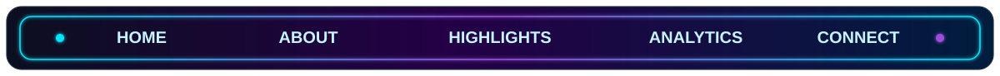
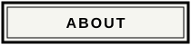
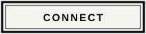
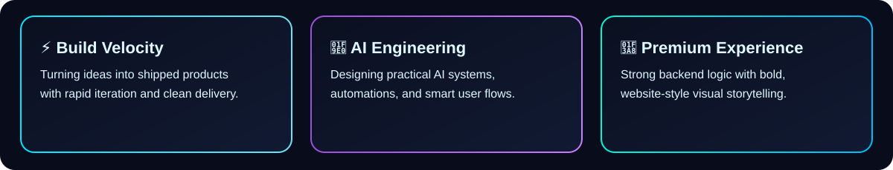

  

  

  
  
  
  
  

  

  
  
  

<table width="100%">
  <tr>
    <td width="60%" valign="top" id="about">
      <h3>⚡ About</h3>
      

        I turn ambitious ideas into real products — fast, scalable, and production-ready.
      

      

        My focus is AI-powered experiences, reliable backend systems, and clean full-stack delivery.
      

      

        I care about two things: strong engineering under the hood and a premium feel on the surface.
      

      

        
        
        
      

    </td>
    <td width="40%" align="center" valign="middle">
      
    </td>
  </tr>
</table>

<h3 id="highlights">🧩 Highlights</h3>

  

  

<h3 id="analytics">📊 Analytics</h3>

  
  

  
  

  

<h3 id="connect">🌐 Connect</h3>

  
  
  
  

  <h3>⚡ Feels like a website. Works like a profile.</h3>

