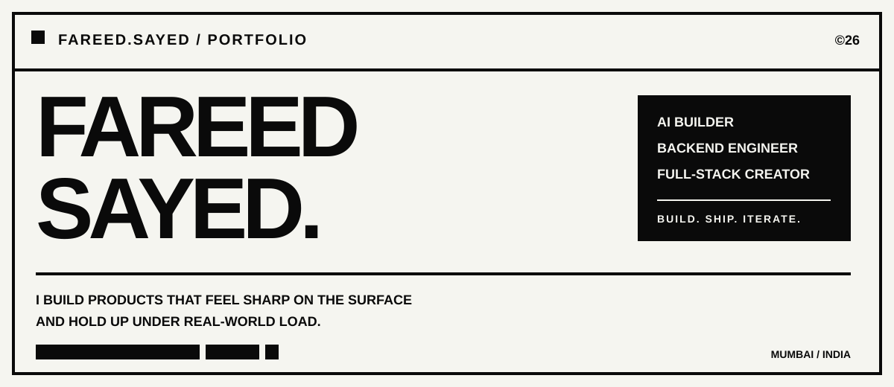

  

 

<!-- SVG NAVIGATION: each visual button is independently clickable -->

  
  
  
  
  

<table width="100%">
  <tr>
    <td><b>STATUS</b></td>
    <td><b>FOCUS</b></td>
    <td><b>MODE</b></td>
    <td><b>BASE</b></td>
  </tr>
  <tr>
    <td>BUILDING</td>
    <td>AI × PRODUCTS</td>
    <td>SHIP FAST / SCALE CLEAN</td>
    <td>MUMBAI, INDIA</td>
  </tr>
</table>

---

<h2 id="01-profile">01 / PROFILE</h2>

<table width="100%">
  <tr>
    <td width="62%" valign="top">
      <h3>ENGINEERING, WITH TASTE.</h3>
      

        I’m <b>Fareed Sayed</b> — a builder working across AI, backend systems and full-stack product engineering.
        I like taking an idea from a rough note to something people can actually use: architecture, APIs, product flows,
        deployment, polish — the whole thing.
      

      

        My sweet spot is where <b>serious engineering</b> meets <b>sharp product experience</b>. Fast is good. Reliable is better.
        Shipping both is the goal.
      

      <pre>
CURRENT OPERATING SYSTEM

→ AI-FIRST PRODUCTS
→ BACKEND ARCHITECTURE
→ PRODUCT ENGINEERING
→ RAPID PROTOTYPING
→ PRODUCTION DELIVERY
      </pre>
    </td>
    <td width="38%" align="center" valign="middle">
      
    </td>
  </tr>
</table>

> **NO DECORATIVE TECH FOR THE SAKE OF IT.**  
> Build the useful thing. Make it fast. Make it feel inevitable.

<a href="#top">↑ BACK TO TOP</a>

---

<h2 id="02-building">02 / BUILDING</h2>

<table width="100%">
  <tr>
    <td width="12%" align="center"><h1>01</h1></td>
    <td>
      <h3>AI-NATIVE PRODUCTS</h3>
      
Agents, intelligent workflows, retrieval, automation and product experiences where AI is part of the system — not a sticker added at the end.

    </td>
  </tr>
  <tr>
    <td width="12%" align="center"><h1>02</h1></td>
    <td>
      <h3>BACKENDS THAT CAN TAKE A HIT</h3>
      
APIs, async workers, queues, databases, caching, auth, integrations and the boring-but-critical pieces that keep software alive after launch day.

    </td>
  </tr>
  <tr>
    <td width="12%" align="center"><h1>03</h1></td>
    <td>
      <h3>FULL-STACK PRODUCT DELIVERY</h3>
      
From UX decisions and frontend systems to deployment and observability. I prefer owning the complete path from idea → shipped product.

    </td>
  </tr>
</table>

  
  
  

<a href="#top">↑ BACK TO TOP</a>

---

<h2 id="03-stack">03 / STACK</h2>

<table width="100%">
  <tr><td width="25%"><b>FRONTEND</b></td><td>Next.js · React · TypeScript · Tailwind CSS</td></tr>
  <tr><td><b>BACKEND</b></td><td>Python · FastAPI · Node.js · REST APIs · Workers</td></tr>
  <tr><td><b>DATA</b></td><td>PostgreSQL · Supabase · Firebase · Redis</td></tr>
  <tr><td><b>AI</b></td><td>LLM Systems · Agents · RAG · Tool Calling · Vision Workflows</td></tr>
  <tr><td><b>INFRA</b></td><td>AWS · Docker · Vercel · GitHub Actions · Cloudinary</td></tr>
</table>

 

  

<a href="#top">↑ BACK TO TOP</a>

---

<h2 id="04-signal">04 / SIGNAL</h2>

<table width="100%">
  <tr>
    <td width="50%" align="center">
      
    </td>
    <td width="50%" align="center">
      
    </td>
  </tr>
</table>

  

<h3 align="center">CONTRIBUTIONS / IN MOTION</h3>

  

  
<b>MORE GITHUB SIGNAL ↓</b>

   
  

    
  

<a href="#top">↑ BACK TO TOP</a>

---

<h2 id="05-contact">05 / CONTACT</h2>

  <h3>HAVE A HARD PROBLEM OR A WEIRD IDEA?</h3>
  
That is usually the interesting part.

  
  
  
  

 

<table width="100%">
  <tr>
    <td align="left"><b>FAREED SAYED © 2026</b></td>
    <td align="right"><b>DESIGNED LIKE A WEBSITE. SHIPPED AS A README.</b></td>
  </tr>
</table>

   
  

